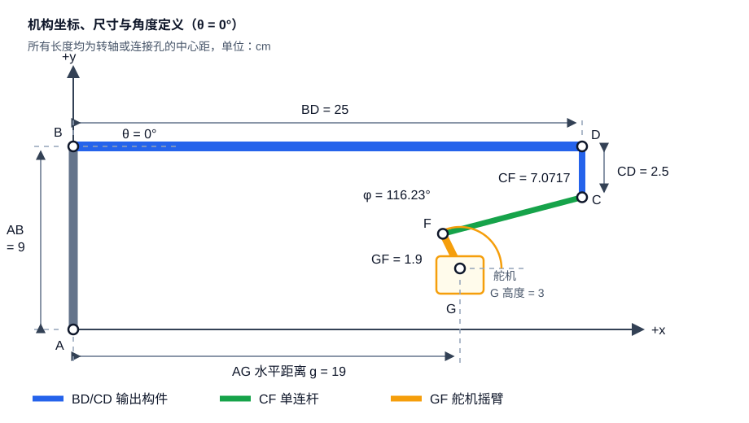
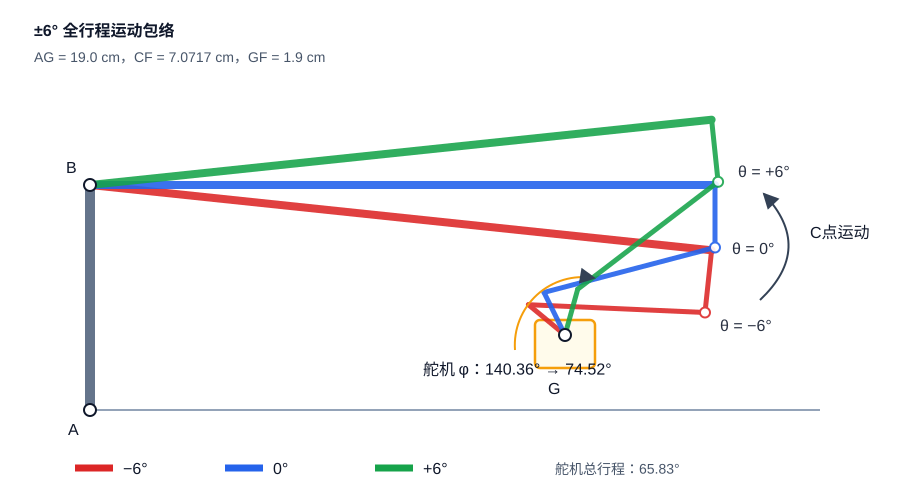
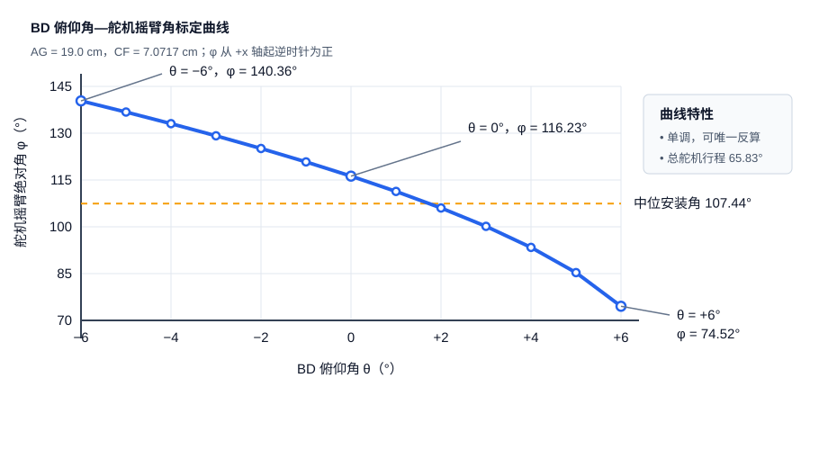

# BD 俯仰机构数学模型与设计参数

## 1. 设计结论

最终机构采用单根刚性连杆 `CF`，取消原方案中的自由转动点 `E`。机构由以下四个活动构件构成：

1. 输出构件：水管 `BD` 与支架 `CD`，二者刚性连接；
2. 连杆：`CF`；
3. 舵机摇臂：`GF`；
4. 机架：固定点 `B` 与固定点 `G` 之间的机架。

推荐的中心距参数为：

| 参数 | 推荐值 | 说明 |
|---|---:|---|
| `AB` | 9.000 cm | 固定竖直支撑高度 |
| `BD` | 25.000 cm | 水管转轴 `B` 到端点 `D` 的距离 |
| `CD` | 2.500 cm | 水管末端支架，默认与 `BD` 垂直并位于其下方 |
| `AG` 水平距离 | **19.000 cm** | 舵机轴 `G` 相对 `A` 的水平位置 |
| `G` 相对 `A` 高度 | 3.000 cm | 舵机轴高度 |
| `GF` | 1.900 cm | 舵机摇臂有效半径，按轴心到连接孔中心计算 |
| `CF` | **7.0717 cm** | 推荐单连杆中心距，制造值可取 70.72 mm |
| `BD` 俯仰范围 | −6°～+6° | 以水平位置为 0° |
| 舵机可用范围 | 270° | 本机构实际只使用约 65.83° |

推荐把 `CF` 做成中心距可微调的拉杆，名义中心距为 **70.72 mm**。所有杆长都应按转轴或球头的孔中心测量。

---

## 2. 建模假设

模型使用二维刚体机构假设：

- `A`、`B`、`G` 为机架上的固定点；
- `BD` 与 `CD` 刚性连接，夹角恒为 90°；
- `B`、`C`、`F`、`G` 均为理想转动副；
- `CF`、`GF`、`BD`、`CD` 均视为不可伸长刚杆；
- 忽略球头间隙、杆件弹性、舵机齿隙和安装变形；
- 本模型只描述运动学，不包含水管载荷、舵机扭矩和结构强度计算。

如果实际 `CD` 不与 `BD` 垂直，或者 `C` 点位于水管另一侧，需要修改第 4 节中的 `C` 点坐标。

---

## 3. 坐标系和角度定义

以 `A` 点为坐标原点：

- 水平向右为 `x` 轴正方向；
- 竖直向上为 `y` 轴正方向；
- 长度单位统一为 cm；
- 数学计算中三角函数使用弧度；
- 文档和控制标定表使用角度。

固定点坐标为：

$$
A=(0,0)
$$

$$
B=(0,9)
$$

$$
G=(g,3)
$$

推荐安装位置取：

$$
g=19.000
$$

因此：

$$
G=(19,3)\ \text{cm}
$$

从 `B` 点观察，舵机轴位置为：

$$
\overrightarrow{BG}=(19,-6)
$$

$$
|BG|=\sqrt{19^2+6^2}=19.9249\ \text{cm}
$$

定义两个运动角：

- $\theta$：`BD` 相对水平面的俯仰角，逆时针/向上为正；
- $\varphi$：舵机摇臂 `GF` 相对 `x` 轴正方向的绝对角，逆时针为正。



*图 1：机构坐标系、固定点、电机位置、中心距和角度正方向。图中为 $\theta=0^\circ$ 的水平状态。*

---

## 4. 水管和 C 点的位置模型

水管 `BD` 的长度为 25 cm，因此 `D` 点坐标为：

$$
D_x=25\cos\theta
$$

$$
D_y=9+25\sin\theta
$$

即：

$$
D(\theta)=
\begin{bmatrix}
25\cos\theta\\
9+25\sin\theta
\end{bmatrix}
$$

`CD` 长 2.5 cm，并且从 `D` 点沿 `BD` 的顺时针法向布置。因此：

$$
\overrightarrow{DC}=
\begin{bmatrix}
2.5\sin\theta\\
-2.5\cos\theta
\end{bmatrix}
$$

于是 `C` 点坐标为：

$$
\boxed{
C_x(\theta)=25\cos\theta+2.5\sin\theta
}
$$

$$
\boxed{
C_y(\theta)=9+25\sin\theta-2.5\cos\theta
}
$$

也可以把 `BC` 看成一根等效输出曲柄。其长度和固定偏角为：

$$
R=|BC|=\sqrt{25^2+2.5^2}=25.1247\ \text{cm}
$$

$$
\delta=\operatorname{atan2}(-2.5,25)=-5.7106^\circ
$$

因此：

$$
C=B+R
\begin{bmatrix}
\cos(\theta+\delta)\\
\sin(\theta+\delta)
\end{bmatrix}
$$

---

## 5. 舵机摇臂 F 点的位置模型

舵机摇臂半径记为：

$$
r=GF=1.9\ \text{cm}
$$

摇臂绝对角为 $\varphi$ 时，`F` 点坐标为：

$$
\boxed{
F_x(\varphi)=g+r\cos\varphi
}
$$

$$
\boxed{
F_y(\varphi)=3+r\sin\varphi
}
$$

在推荐位置 $g=19$ 时：

$$
F(\varphi)=
\begin{bmatrix}
19+1.9\cos\varphi\\
3+1.9\sin\varphi
\end{bmatrix}
$$

---

## 6. 机构闭环方程

单连杆 `CF` 的中心距记为：

$$
L=CF=7.0717\ \text{cm}
$$

刚性连杆约束为：

$$
|C-F|=L
$$

展开后得到机构的基本闭环方程：

$$
\boxed{
[C_x(\theta)-F_x(\varphi)]^2+
[C_y(\theta)-F_y(\varphi)]^2=L^2
}
$$

该方程就是舵机位置与 `BD` 俯仰角之间的完整隐式数学模型。

---

## 7. 已知 BD 俯仰角，计算舵机角度

这是控制程序最常用的正向计算：输入目标俯仰角 $\theta$，求舵机摇臂绝对角 $\varphi$。

先计算 `C` 点相对 `G` 点的坐标：

$$
\Delta x=C_x(\theta)-g
$$

$$
\Delta y=C_y(\theta)-3
$$

$$
\rho=\sqrt{\Delta x^2+\Delta y^2}
$$

定义：

$$
\alpha=\operatorname{atan2}(\Delta y,\Delta x)
$$

将闭环方程展开：

$$
(\Delta x-r\cos\varphi)^2+
(\Delta y-r\sin\varphi)^2=L^2
$$

整理得到：

$$
\Delta x\cos\varphi+\Delta y\sin\varphi
=\frac{\rho^2+r^2-L^2}{2r}
$$

利用：

$$
\Delta x\cos\varphi+\Delta y\sin\varphi
=\rho\cos(\varphi-\alpha)
$$

得到两个理论装配分支：

$$
\varphi=\alpha\pm
\arccos\left(
\frac{\rho^2+r^2-L^2}{2\rho r}
\right)
$$

本设计采用图示装配分支，即加号分支：

$$
\boxed{
\varphi(\theta)=
\operatorname{atan2}(\Delta y,\Delta x)
+\arccos\left(
\frac{\rho^2+r^2-L^2}{2\rho r}
\right)
}
$$

反余弦的输入在程序中应限制到 $[-1,1]$，以避免浮点舍入误差产生无效值。

机构可达条件为：

$$
\boxed{
|\rho-r|\le L\le \rho+r
}
$$

如果不满足该条件，说明对应的目标俯仰角在当前杆长和安装位置下无法到达。

---

## 8. 已知舵机角度，反算 BD 俯仰角

先通过第 5 节计算 `F` 点，然后定义从 `B` 到 `F` 的向量：

$$
w_x=F_x
$$

$$
w_y=F_y-9
$$

$$
w=\sqrt{w_x^2+w_y^2}
$$

$$
\beta=\operatorname{atan2}(w_y,w_x)
$$

由三角形 `BCF` 的余弦定理：

$$
\cos(\theta+\delta-\beta)
=\frac{R^2+w^2-L^2}{2Rw}
$$

本设计工作分支的反解为：

$$
\boxed{
\theta(\varphi)=
\beta-\delta+
\arccos\left(
\frac{R^2+w^2-L^2}{2Rw}
\right)
}
$$

其中：

$$
R=25.1247\ \text{cm},\qquad
\delta=-5.7106^\circ
$$

余弦方程还存在另一个装配分支，但不属于本机构的 −6°～+6° 工作区间。软件应在首次标定时确认使用正确分支。

---

## 9. 杆长和舵机位置的优化过程

设计变量为：

$$
19\le g\le21
$$

以及单连杆长度 $L$。

优化目标是在完整输出范围内使舵机总转角最小：

$$
\boxed{
J(g,L)=
\max_{-6^\circ\le\theta\le6^\circ}\varphi(\theta)
-
\min_{-6^\circ\le\theta\le6^\circ}\varphi(\theta)
}
$$

对于给定的 $g$，杆长必须在所有目标角都可达的公共区间内：

$$
\max_{\theta}\left[\rho(\theta)-r\right]
\le L\le
\min_{\theta}\left[\rho(\theta)+r\right]
$$

当 $g=19$ 时：

$$
\rho(-6^\circ)=5.6736\ \text{cm}
$$

$$
\rho(+6^\circ)=8.6630\ \text{cm}
$$

所以杆长公共可行区间约为：

$$
6.7630\le L\le7.5736\ \text{cm}
$$

在该区间内对 $J(19,L)$ 进行一维数值搜索，得到：

$$
\boxed{L_{opt}=7.0717\ \text{cm}}
$$

再对允许的 `AG` 位置进行比较：

| $g=AG$（cm） | 对应最优 `CF`（cm） | 最小舵机行程 |
|---:|---:|---:|
| **19.0** | **7.0717** | **65.83°** |
| 19.5 | 6.6630 | 71.59° |
| 20.0 | 6.2676 | 79.08° |
| 20.5 | 5.8881 | 89.49° |
| 21.0 | 5.5278 | 106.48° |

因此在允许的调整范围内，应优先把舵机轴安装在：

$$
\boxed{G=(19,3)\ \text{cm}}
$$

---

## 10. 端点校核和舵机标定数据

采用：

$$
g=19.000,\quad r=1.900,\quad L=7.0717
$$



*图 2：$\theta=-6^\circ$、$0^\circ$、$+6^\circ$ 三个关键位置的叠加图。水管向上运动时，当前装配分支的舵机角 $\varphi$ 减小。*

得到关键位置：

| `BD` 俯仰角 $\theta$ | 摇臂绝对角 $\varphi$ | 相对推荐中位角 |
|---:|---:|---:|
| −6° | 140.357° | +32.917° |
| 0° | 116.234° | +8.794° |
| +6° | 74.523° | −32.917° |

舵机总机械行程为：

$$
140.357^\circ-74.523^\circ
=\boxed{65.834^\circ}
$$

为了让使用的舵机行程在中位两侧对称，推荐机械安装中位角为：

$$
\varphi_c=
\frac{140.357^\circ+74.523^\circ}{2}
=\boxed{107.440^\circ}
$$

定义发送给舵机的相对机械指令：

$$
u_\varphi=\varphi-\varphi_c
$$

则：

$$
-32.917^\circ\le u_\varphi\le+32.917^\circ
$$

注意：当 `BD` 水平时，舵机指令不是几何行程正中，而是：

$$
u_\varphi(0^\circ)=116.234^\circ-107.440^\circ
=+8.794^\circ
$$

这是机构本身的非线性造成的，不是计算误差。



*图 3：目标俯仰角 $\theta$ 与舵机绝对角 $\varphi$ 的标定关系。曲线在工作区间内单调，因此可以唯一正算和反算。*

完整的 1° 标定表如下：

| $\theta$ | $\varphi$ 绝对角 | $u_\varphi=\varphi-107.440^\circ$ |
|---:|---:|---:|
| −6° | 140.357° | +32.917° |
| −5° | 136.782° | +29.342° |
| −4° | 133.053° | +25.613° |
| −3° | 129.160° | +21.720° |
| −2° | 125.084° | +17.644° |
| −1° | 120.791° | +13.351° |
| 0° | 116.234° | +8.794° |
| +1° | 111.347° | +3.907° |
| +2° | 106.031° | −1.409° |
| +3° | 100.134° | −7.306° |
| +4° | 93.396° | −14.044° |
| +5° | 85.306° | −22.134° |
| +6° | 74.523° | −32.917° |

`BD` 向上转动时，当前装配分支的舵机绝对角减小。因此控制方向可能与常规舵机正方向相反，最终应由安装方向参数统一处理。

---

## 11. 270° 舵机内部位置的换算

若把 270° 舵机的内部位置中点定义为：

$$
\psi_c=135^\circ
$$

并在装配时使内部位置 $135^\circ$ 对应摇臂绝对角 $107.440^\circ$，则舵机内部位置可以写成：

$$
\boxed{
\psi=135^\circ+s(\varphi-107.440^\circ)
}
$$

其中方向参数：

- $s=+1$：舵机内部角度增加时，摇臂绝对角也增加；
- $s=-1$：舵机安装方向相反。

取 $s=+1$ 时，三个关键内部位置为：

| `BD` 俯仰角 | 舵机内部位置 $\psi$ |
|---:|---:|
| −6° | 167.917° |
| 0° | 143.794° |
| +6° | 102.083° |

取 $s=-1$ 时，三个关键内部位置为：

| `BD` 俯仰角 | 舵机内部位置 $\psi$ |
|---:|---:|
| −6° | 102.083° |
| 0° | 126.206° |
| +6° | 167.917° |

当前实机观察到原 `−3°`命令会使水管右端抬高，说明舵机为 $s=-1$反向安装。固件因此使用第二组映射，并以 `−5°→0°→+5°→0°`执行空载三点标定，以增大姿态采样行程和信噪比。

如果舵机使用脉宽控制，并且数据手册给出的 0°～270° 对应脉宽为 $P_{min}$～$P_{max}$，则：

$$
\boxed{
P=P_{min}+
\frac{\psi}{270^\circ}
\cdot(P_{max}-P_{min})
}
$$

不同型号舵机的有效脉宽范围并不完全相同，必须使用实际舵机说明书或实测标定值，不能默认所有舵机都是同一个脉宽范围。

---

## 12. C 语言计算示例

以下函数根据目标 `BD` 俯仰角计算摇臂绝对角。输入和输出单位均为度。

```c
#include <math.h>

#define DEG_TO_RAD 0.01745329251994329577f
#define RAD_TO_DEG 57.29577951308232088f

static float clampf_local(float value, float lower, float upper)
{
    if (value < lower) return lower;
    if (value > upper) return upper;
    return value;
}

float linkage_servo_angle_deg(float pitch_deg)
{
    const float BD = 25.0f;
    const float CD = 2.5f;
    const float G_X = 19.0f;
    const float G_Y = 3.0f;
    const float HORN = 1.9f;
    const float LINK = 7.0716718f;

    const float theta = pitch_deg * DEG_TO_RAD;

    const float cx = BD * cosf(theta) + CD * sinf(theta);
    const float cy = 9.0f + BD * sinf(theta) - CD * cosf(theta);

    const float dx = cx - G_X;
    const float dy = cy - G_Y;
    const float rho = sqrtf(dx * dx + dy * dy);

    float acos_arg =
        (rho * rho + HORN * HORN - LINK * LINK) /
        (2.0f * rho * HORN);

    acos_arg = clampf_local(acos_arg, -1.0f, 1.0f);

    const float phi = atan2f(dy, dx) + acosf(acos_arg);
    return phi * RAD_TO_DEG;
}

float linkage_servo_relative_command_deg(float pitch_deg)
{
    const float INSTALL_CENTER_DEG = 107.4401f;
    return linkage_servo_angle_deg(pitch_deg) - INSTALL_CENTER_DEG;
}
```

输入目标角前建议先进行范围限制：

```c
if (pitch_deg < -6.0f) pitch_deg = -6.0f;
if (pitch_deg >  6.0f) pitch_deg =  6.0f;
```

---

## 13. 装配和实机标定步骤

1. 固定 `A`、`B`，确认 `AB=90.00 mm`，并使 `AB` 竖直。
2. 把舵机轴中心安装到 `G=(190.00 mm, 30.00 mm)`。
3. 确认摇臂连接孔中心距 `GF=19.00 mm`。
4. 制作中心距约 `CF=70.72 mm` 的可调连杆。
5. 将 `BD` 调到机械水平，记录水平仪或角度传感器读数作为 $\theta=0^\circ$。
6. 在水管水平时，把摇臂装到约 $\varphi=116.23^\circ$ 的实际位置。
7. 分别命令 `BD` 到 −6°、0°、+6°，检查实际舵机角是否接近 140.36°、116.23°、74.52°。
8. 通过微调 `CF` 中心距和软件零点补偿消除制造误差。
9. 确认全行程内连杆、球头、水管、舵机外壳之间没有碰撞。
10. 最后再建立舵机 PWM 或总线位置值与实际摇臂角之间的实测映射。

---

## 14. 使用限制和误差来源

以下因素会使实机结果偏离理论模型：

- `AG` 实际水平距离不是 19.00 cm；
- `G` 的实际高度不是 3.00 cm；
- `CD` 与 `BD` 不完全垂直；
- 杆长按外形长度而不是孔中心距测量；
- 舵机摇臂有效半径不是准确的 1.90 cm；
- 球头、销轴或舵机减速齿轮存在间隙；
- 水管和支架在载荷下产生弹性变形；
- 舵机内部位置与实际机械角度不完全线性。

因此，理论模型用于确定结构尺寸和初始控制量，最终精度应通过实机角度传感器或水平仪进行零点、增益和查表修正。
